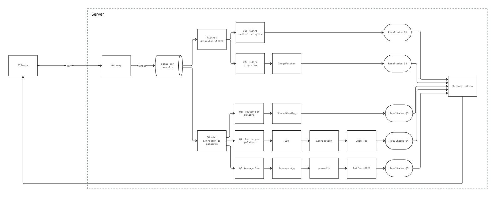
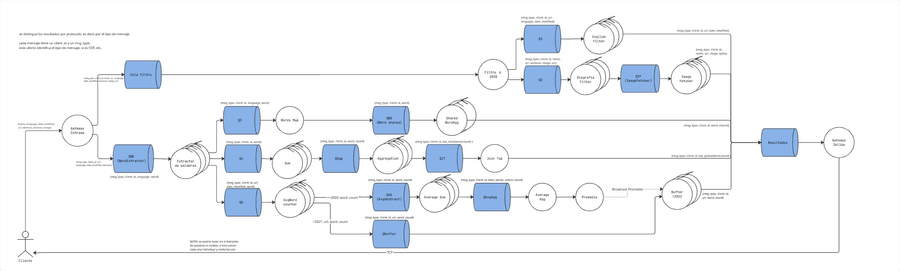
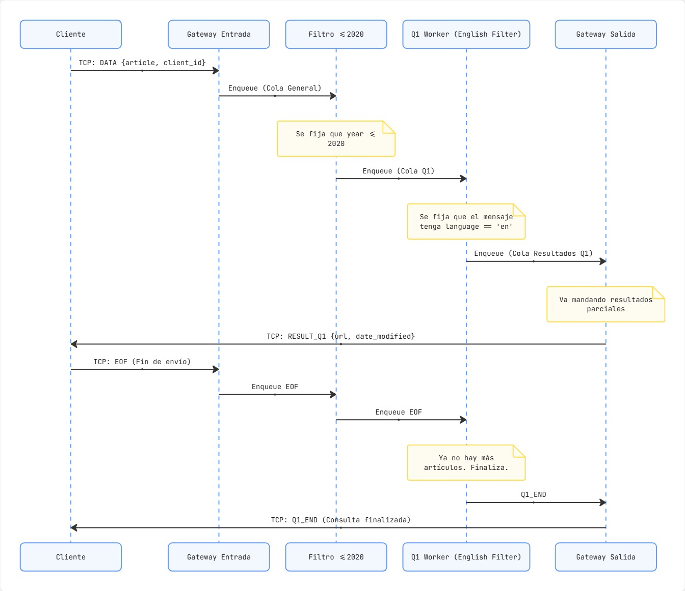
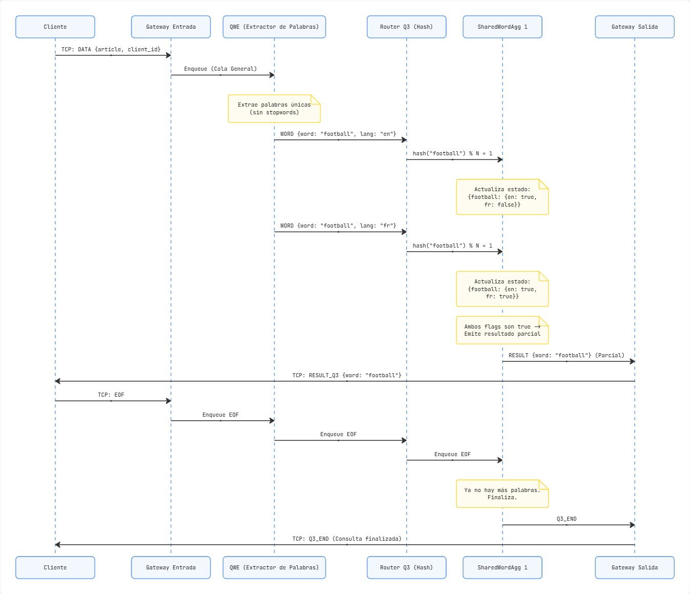
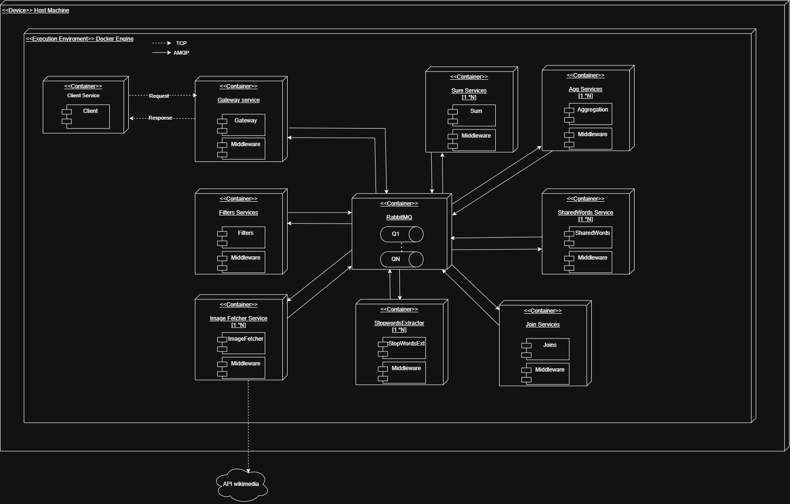
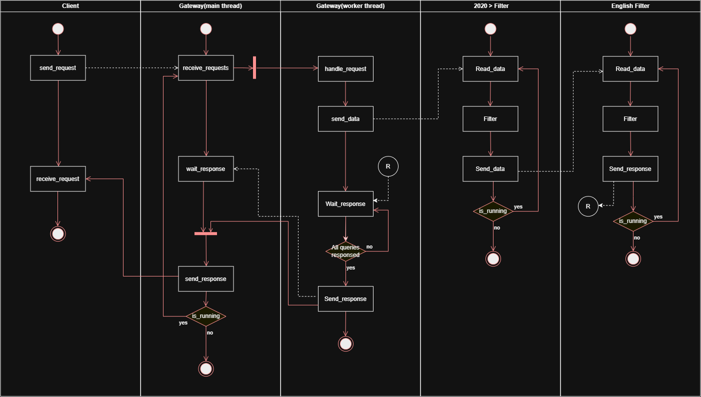
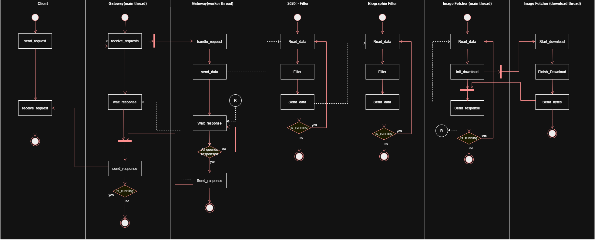
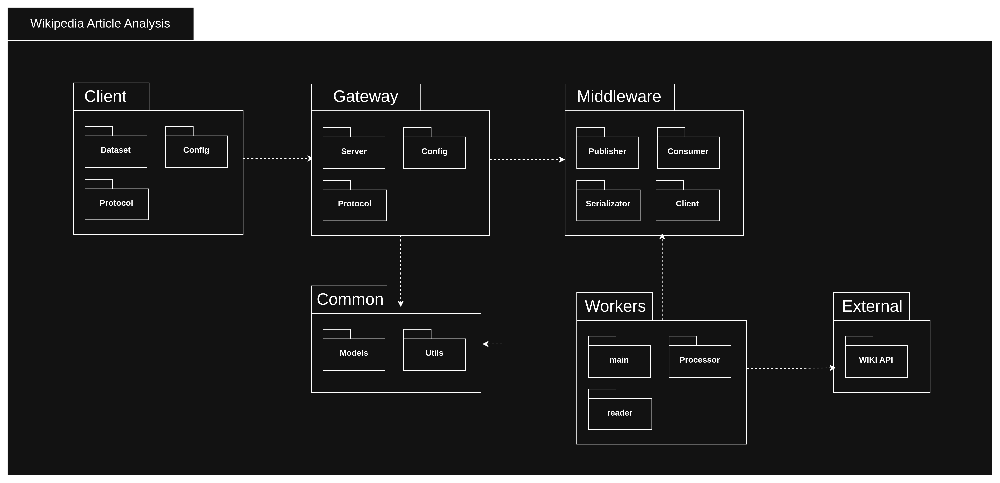

# Informe de Diseño - Sistemas Distribuidos

Wikipedia Article Analysis

## Introducción y Objetivo
El presente documento describe el diseño de un sistema distribuido para el análisis de un conjunto de artículos de Wikipedia en francés e inglés. El sistema debe resolver cinco consultas específicas de manera concurrente y aislada para múltiples clientes

El diseño prioriza la escalabilidad horizontal, la reutilización de operaciones y el aislamiento de datos por cliente. A continuación se presentan las vistas arquitectónicas que modelan la solución.

## DAG (Directed Acyclic Graph)
Vista lógica de alto nivel que representa el flujo de tareas y dependencias del sistema.

El DAG muestra la reutilización del filtro <= 2020 para Q1 y Q2, y la bifurcación del extractor de palabras (QWords) hacia Q3, Q4 y Q5. Se observa la convergencia final de todos los resultados hacia el Gateway de salida.

## Diagrama de Robustez
Vista de infraestructura lógica que detalla colas, workers y escalabilidad.

## Diagramas de Secuencia
Vista dinámica que muestra el intercambio de mensajes en el tiempo.

#### 4.1. Secuencia Q1 (Filtro Inglés)

Flujo simple de un artículo. Muestra la propagación del mensaje EOF desde el cliente hasta el worker de Q1, el aislamiento por client_id y la emisión del resultado parcial y final (Q1_END).

#### 4.2. Secuencia Q3 (Palabras Compartidas)

Evidencia el uso del hash(word) % N para garantizar que la misma palabra caiga en el mismo SharedWordAgg. Muestra cómo se emite un resultado parcial apenas se detecta la palabra en ambos idiomas (EN/FR).

## Diagrama de Despliegue

Vista física de nodos y contenedores

## Diagrama de Actividades

## Diagrama de Paquetes

## Analisis sobre el volumen de datos
| Language | Rows      | Shards | Size      |
| -------- | --------- | ------ | --------- |
| English  | 7,597,149 | 86     | 34.61 GiB |
| French   | 2,871,732 | 26     | 9.81 GiB  |

Total rows: 10,468,881
Total Parquet size: 44.42 GiB

### Supuestos
- La idea es DISEÑARLO para que soporte los 10 millones de registros pero en pruebas locales se hace con un volumen reducido

## Decisiones de diseño
- Separar los articulos por año y luego contar sus palabras es mejor que hacerlo en orden inverso, en la primer situación se descartan los mensajes pero la segunda implica contar todas las palabras de un abstract sin la garantía de que se vaya a filtrar posteriormente
Esto ocurre tanto para Q1, Q2 y Q5

- Se intentó tener un equilibrio entre las cantidades de operaciones que se repiten y las operaciones que se hacen dos veces redundante para no tener una logica muy compleja. Por ejemplo un modulo Sum podría ser usado por Q4 y Q5 pero al tener dos procesos totalmente distintos se prefirió "repetir" la logica del sumado, aunque por codigo es posible hacer optimizaciones. Lo mismo pensamos para los articulos <=2020 para Q1, Q2 y Q5. Se podría separar y volver a hacer un conteo para Q5 y luego para Q1 y Q2 pero se decidió unificar ya que la logica para filtrar no es muy compleja en este caso.

